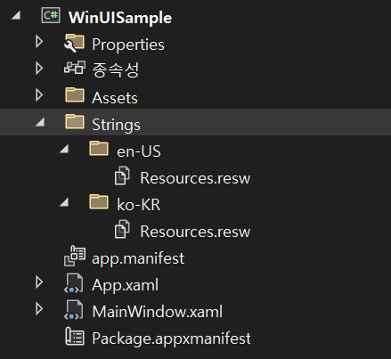
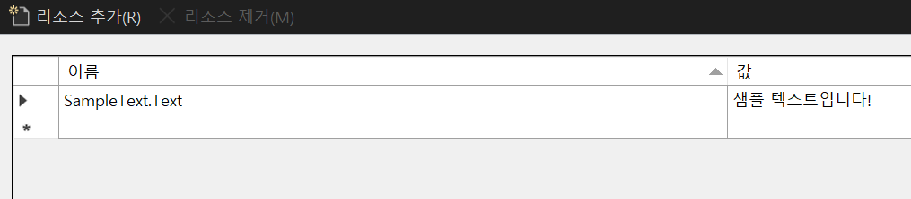
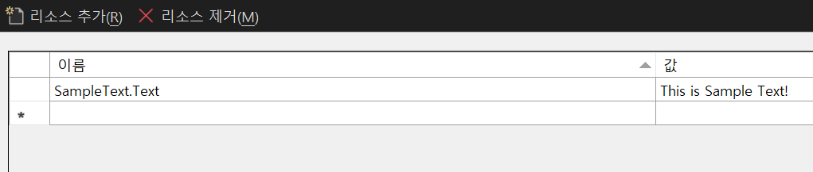
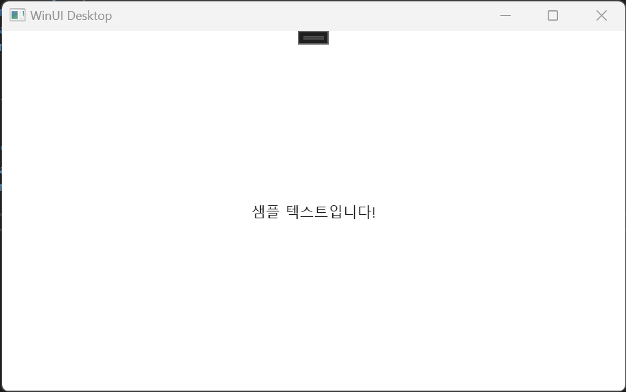

공식 문서: <https://learn.microsoft.com/en-us/windows/apps/winui/winui3/localize-winui3-app>

UWP와 그 후신인 WinUI 3(이하 이 둘을 묶어 불러야 할 일이 있을 때는 WinUI로 칭하도록 하겠다.)에서는 간단한 방법으로 애플리케이션을 지역화할 수 있다.

다만 지역화를 적용하는 방법은 크게 애플리케이션과 지역화 대상이 동일한 어셈블리인지, 서로 다른 어셈블리인지에 따라 조금 다를 수 있다.

## 1. 동일한 어셈블리일 때

애플리케이션과 지역화할 대상이 동일한 어셈블리 내에 있다면 사용법은 정말로 간단한데, 지역화할 프로젝트에서 아래 순서대로 진행하면 된다.

1. 대상 프로젝트에 폴더를 생성한다. (폴더명은 어떤 것으로 하든 무관하지만, 일반적으로는 Strings로 명명한다.)
2. 새로 만든 폴더 안에 지역화할 언어의 ISO 언어 코드명으로 폴더를 생성한다.(ex. ko-KR, en-US)
3. 각 언어별 폴더 안에 리소스 파일(.resw)을 추가하고, Resources로 명명한다.

위의 프로세스대로 지역화를 지원하는 WinUI 3 앱을 만들어 보자.

패키지된 WinUI 3 앱 프로젝트를 생성한 후, MainWindow를 아래와 같이 구성한다.

```xml
<Window
    x:Class="WinUISample.MainWindow"
    xmlns="http://schemas.microsoft.com/winfx/2006/xaml/presentation"
    xmlns:x="http://schemas.microsoft.com/winfx/2006/xaml"
    xmlns:local="using:WinUISample"
    xmlns:d="http://schemas.microsoft.com/expression/blend/2008"
    xmlns:mc="http://schemas.openxmlformats.org/markup-compatibility/2006"
    mc:Ignorable="d">

	<Grid>
		<TextBlock x:Uid="SampleText"
				   VerticalAlignment="Center"
				   HorizontalAlignment="Center"/>
	</Grid>
</Window>
```

Uid는 리소스 파일과 컨트롤을 연결하기 위해 사용된다. WinUI 앱 실행 시 리소스 파일을 로드한 후, Uid 문자열로 시작하는 각 Property에 대한 리소스 키(MSDN에서는 Property Identifier, 즉 **속성 식별자**로 칭한다.)를 찾아 해당하는 Property를 모두 덮어쓴다.

무슨 말이냐 하면, 리소스 파일에 SampleText.Text라는 리소스 키가 있고 그 값이 "Sample Text"라면, Uid가 SampleText인 컨트롤의 Text Property와 연결되어 리소스 파일의 SampleText.Text로 지정된 문자열이 할당되므로 최종적으로 Sample Text가 출력된다는 의미다.

마찬가지로 SampleButton.Content라는 리소스 키가 있고 그 값이 "Sample Button"이라면, Uid가 SampleButton인 컨트롤이 있을 때 그 Content Property에 "Sample Button"이라는 문자열이 할당되어 Button 컨트롤의 Content가 "Sample Button"이 된다.

주의해야 할 점은 **속성 식별자**는 연결된 Xaml 컨트롤의 Property 이름과 정확하게 일치해야 한다는 것이다. 가령 바로 위 문단에서 속성 식별자를 "SampleButton.Content"에서 "SampleButton.Text"로 변경한다면, Button 컨트롤에는 Text Property가 없기 때문에 런타임 시 예외가 발생한다.

확인을 위해 지역화를 위한 리소스 파일을 추가해 보자. 프로젝트 안에 Strings 폴더를 만든 후, 각 언어별 폴더를 추가하고 그 아래에 리소스 파일을 추가한다. 주의해야 할 점은 리소스 파일 이름은 기본적으로 **Resources.resw**여야 하며, 파일 이름을 바꾸고자 한다면 지역화를 위해 별도로 추가 작업을 해야 한다.





*Strings/ko-KR/Resources.resw*



*Strings/en-US/Resources.resw*

다음으로 위와 같이 적절한 속성 식별자를 키 값으로 하는 문자열을 언어별로 추가해 준다.

이제 빌드 후 실행해 보면, 사용하는 환경의 언어에 맞게 텍스트가 표시되는 것을 확인할 수 있다.



만약 Xaml이 아닌 Code Behind에서 문자열 리소스를 활용하고 싶다면, ResourceLoader를 활용해야 한다. 다음과 같이 확장 메서드를 정의하여 사용한다.

```csharp
using Microsoft.Windows.ApplicationModel.Resources;

public static class ResourceExtension
{
	private static readonly ResourceLoader _resourceLoader = new();

	public static string GetLocalized(this string resourceKey) => _resourceLoader.GetString(resourceKey);
}
```

```csharp
public sealed partial class MainWindow : Window
{
	public MainWindow()
	{
		this.InitializeComponent();
		xSampleText.Text = "SampleText/Text".GetLocalized();
	}
}
```

Xaml이 아니라 코드에서 리소스를 참조하고자 할 경우, **속성 식별자**는 .이 아닌 /로 구분해야 한다는 점에 유의하자.

빌드하면 Xaml에서 Uid를 통해 접근했을 때와 동일한 텍스트가 표시된다.

## 2. 서로 다른 어셈블리일 때

애플리케이션과 지역화 대상이 서로 다른 어셈블리에 있다면 상황이 조금 복잡해질 수 있다. 가령 컨트롤이나 View 등 Presentation Logic과 Application Service Logic을 분리하고자 하는 경우라든지, 그 외 기능별로 어셈블리를 분리하고 싶은 경우, 라이브러리를 개발하는 경우 등 별개의 어셈블리에 개별로 지역화를 적용해야 할 상황이 발생할 수 있다.

문제는, **WinUI의 리소스 관리는 어셈블리 단위로 이루어진다**는 것이다. 위에서 설명한 방법은 애플리케이션과 지역화 대상이 서로 다른 어셈블리에 있는 상황에서는 제대로 동작하지 않는다.

WinUI 앱 빌드 시 리소스 파일을 이용해 PRI 파일을 생성하고 이를 통해 리소스 맵이라고 하는 리소스 파일의 컬렉션을 추가하는데, 어셈블리가 다르다면 생성되는 PRI 파일도 다르고, 각 어셈블리의 리소스 역시 별도의 리소스 맵에 추가된다. 따라서 위에서 설명한 방법 중 Xaml에서 Uid를 이용하는 방법은 속성 식별자를 찾지 못해 아무런 텍스트도 표시되지 않으며, 코드를 이용하는 방법도 빈 문자열을 반환하거나 심지어 런타임 예외를 발생할 수도 있다.

즉 코드에서 리소스에 접근할 때 사용하는 ResourceLoader 클래스의 기본 생성자는 시작 프로젝트의 PRI 파일(일반적으로 resources.pri 파일이다.)을 이용해 리소스 맵을 생성하는데, 시작 프로젝트에 아무런 리소스 파일도 없는 상황이라면 리소스 맵을 찾지 못해 예외를 발생하는 것이다.

그렇다면 해결방법은 없냐? 하면 그건 아니지만, 조금 번거로운 과정을 거쳐야 한다.

먼저, 리소스 활용 시나리오를 명확하게 잡아놓고 갈 필요가 있다고 생각한다.

1. **리소스 파일이 반드시 대상과 별개의 어셈블리에 위치해야 하는가? (즉, 대상과 동일한 어셈블리에 존재해도 무방한가?)**
2. **코드 비하인드에서 리소스에 접근해야 할 일이 있는가?**
3. **리소스 키는 대상 어셈블리 내에 위치한 리소스 파일에서 찾을 것인가? 외부 어셈블리의 리소스 파일에서 찾을 것인가?**

**1) 리소스 파일이 반드시 대상과 별개의 어셈블리에 위치해야 하는가? (즉, 대상과 동일한 어셈블리에 존재해도 무방한가?)**

WinUI의 리소스 관리는 어셈블리 단위로 이루어지므로, 리소스 파일이 대상과 동일한 어셈블리 내에 있어도 무방하다면 애플리케이션이 위치한 어셈블리에는 리소스 파일을 추가하지 않고, 지역화가 필요한 객체가 존재하는 어셈블리 내에 리소스 파일을 추가하는 것을 고려해 볼 수 있다. 만약 코드 비하인드에서 리소스에 접근해야 할 일이 없고 Uid를 통해서만 접근하는 상황이라면, 대상 어셈블리에 리소스 파일을 추가하는 것만으로 목표를 달성할 수 있다.

**2) 코드 비하인드에서 리소스에 접근해야 할 일이 있는가?**

코드 비하인드에서 리소스에 접근하는 것을 고려해야 하는 상황이라면 대상 어셈블리에 리소스 파일을 추가하는 것에 더해서 ResourceLoader를 이용하는 확장 메서드를 조금 수정해 주어야 한다.

앞서 ResourceLoader가 시작 프로젝트의 PRI 파일을 이용해 리소스 맵을 생성한다고 했다. ResourceLoader의 GetDefaultResourceFilePath 메서드를 호출하면 시작 프로젝트인 애플리케이션 패키지의 resources.pri 파일 경로를 반환하는 것을 확인할 수 있을 것이다.

그렇다면 resources.pri 파일 대신에 대상 어셈블리에서 생성하는 pri 파일을 이용해 ResourceLoader를 생성한다면 대상 어셈블리 내에 존재하는 리소스 파일을 가지고 리소스 맵을 구성하지 않을까?

실제로 ResourceLoader 클래스에는 다른 생성자가 추가로 정의되어 있다.

```csharp
public ResourceLoader(string fileName);
public ResourceLoader(string fileName, string resourceMap);
```

첫 번째 생성자는 동일 어셈블리의 다른 리소스 파일을 참조하려고 하는 경우 사용하는 생성자인데, 지금은 별개 어셈블리이므로 넘어간다.(파라미터 이름을 보면 알겠지만 지금은 리소스 맵이 아닌 PRI 파일 이름을 받고 있는데, 버그거나 MSDN 문서가 잘못된 것으로 보인다.)

그럼 두 번째 생성자를 살펴보자.

첫 번째 파라미터는 사용할 PRI 파일의 주소고, 두 번째 파라미터는 리소스 맵의 URI 주소이다.

PRI 파일 주소의 경우 참조되는 라이브러리의 PRI 파일 이름은 기본적으로 어셈블리 이름과 일치하기 때문에, Assembly 클래스의 GetExecutingAssembly 메서드를 이용하면 쉽게 가져올 수 있다.

리소스 맵의 URI 주소는 Assembly 이름 + 리소스 파일 이름이므로, 역시 쉽게 가져올 수 있다.

```csharp
// 대상 어셈블리 안에 위치
public static class ResourceExtension
{
	private static readonly ResourceLoader _resourceLoader;

	static ResourceExtension()
	{
		var dir = Path.GetDirectoryName(ResourceLoader.GetDefaultResourceFilePath());
		_resourceLoader = new(Path.Join(dir, $"{Assembly.GetExecutingAssembly().GetName().Name}.pri"), $"{Assembly.GetExecutingAssembly().GetName().Name}/Resources");
	}

	public static string GetLocalized(this string resourceKey)
	{
		return _resourceLoader.GetString(resourceKey);
	}
}
```

두 번째 생성자를 이용하는 것으로 하고, ResourceExtension을 위와 같이 수정한다. 빌드 후 실행해 보면 대상 어셈블리 내에 리소스 파일이 존재한다면 예외를 발생하지 않고 적절한 값을 찾아 반환하는 것을 확인할 수 있다.

**3) 리소스 키는 대상 어셈블리 내에 위치한 리소스 파일에서만 찾을 것인가? 외부 어셈블리의 리소스 파일에서 찾을 것인가?**

1번과 2번에서 다룬 시나리오는 모두 대상 어셈블리 내에 위치한 리소스 파일에서만 찾는 것을 전제로 수행했다. 그러나 외부 어셈블리, 혹은 대상 어셈블리와 외부 어셈블리를 포함한 모든 어셈블리에서 리소스를 찾아야 하는 경우가 있을 수도 있다.

만약 모든 어셈블리의 리소스 파일을 대상으로 리소스 키를 찾아야 할 필요가 있다면, 해당 어셈블리들의 PRI 파일을 이용해 리소스 맵을 생성해 두고, 리소스 키 검색 요청이 들어올 때마다 리소스 맵들을 순회하며 적절한 값이 있는지 찾고, 적절한 값이 있다면 반환해 주는 식으로 구현하면 쉽게 구현할 수 있을 것 같다.

```csharp
public static class ResourceExtension
{
	private static List<ResourceMap> _resourceMaps;

	static ResourceExtension()
	{
		ResourceManager resourceManager = new();
		var mainResourceMap = resourceManager.MainResourceMap;

		// 기본 리소스 맵 (resources.pri)
		var defaultResourceMap = mainResourceMap.GetSubtree("Resources");

		_resourceMaps = AppDomain.CurrentDomain.GetAssemblies().Where(assembly =>
		{
			try
			{
				mainResourceMap.GetSubtree($"{assembly.GetName().Name}/Resources");
				return true;
			}
			catch
			{
				return false;
			}
		}).Select(assembly => mainResourceMap.GetSubtree($"{assembly.GetName().Name}/Resources")).Prepend(defaultResourceMap).ToList();
	}

	public static string GetLocalized(this string resourceKey)
	{
		return _resourceMaps.Select(map => map.TryGetValue(resourceKey)?.ValueAsString).Where(val => !string.IsNullOrEmpty(val)).FirstOrDefault() ?? string.Empty;
	}
}
```

아이디어를 바탕으로 ResourceExtension을 수정한다. 먼저 리소스 맵에 직접 접근하기 위해 ResourceLoader 대신 ResourceMap으로 바꾸었고, static 생성자에서 모든 어셈블리를 가져와 Resource.resw 파일이 존재하는 어셈블리의 리소스 맵을 \_resourceMaps 리스트에 추가했다.

그리고 GetLocalized 메서드가 호출될 때 리소스 맵을 순회하며 값이 있는지 찾고, 있다면 값을, 없다면 빈 문자열을 반환하도록 만들었다.

빌드 후 앱을 실행하면 정상적으로 동작하는 것을 확인할 수 있다.

사실 세부적으로 들어간다면 생각보다 다듬어야 할 구석이 많지만, 큰 틀은 대충 다룬 듯하니 일단은 되는 것에 의의를 두기로 하고...

나중에 보충할 만한 부분이 있다면 추가로 글을 써서 덧붙이는 것으로 한다.

그럼 WinUI 지역화하기 끝!
