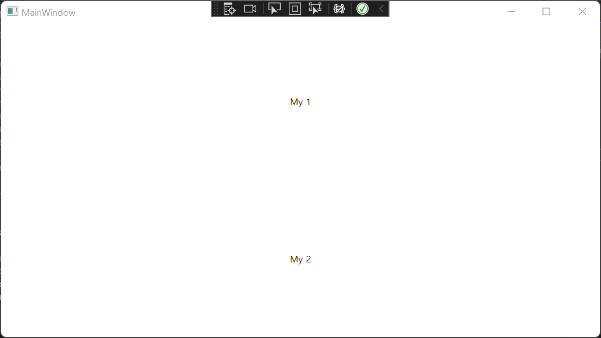

MVVM 패턴을 설명하는 포스팅을 살펴보면 일반적으로 MVVM의 각 구성 요소는 다음과 같이 정의된다.

**1. Model** - 데이터 및 데이터의 비즈니스 로직을 포함하는 객체

**2. View** - 사용자에게 데이터를 보여주기 위한 부분**만**을 담당하는 UI 객체

**3. ViewModel** - View의 보여주기 위한 부분 외의 동작을 추상화한 객체

View가 사용자에게 데이터를 보여주기 위한 부분만을 담당한다는 것은, 일반적으로 ViewModel이 연결되지 않은 View는 UI 외의 모든 동작이 불가능해야 함을 의미한다. 데이터를 다루거나 로직을 실행하는 등의 모든 동작은 ViewModel 또는 Model 영역에서 처리하며, ViewModel에서 추상화된 동작이 View를 통해 구체화되어 사용자에게 제공된다고 볼 수 있다.

즉 MVVM 패턴에서 중요한 것은 View에서 Model을 다루는 동작은 잘 추상화하여 ViewModel로 분리하고, View는 보여주는 부분만 담당함으로써 프리젠테이션 로직과 비즈니스 로직의 결합도를 최대한 낮추는 것이 관건이라고 볼 수 있다. MVVM 패턴이 적용된 애플리케이션은 최종적으로 ViewModel과 View를 연결함으로써 온전한 기능을 갖추게 된다.

그렇다면 이 ViewModel과 View를 어떻게 연결할 수 있을까?

**1. View에서 직접 DataContext에 ViewModel을 대입하는 방법**

**1) 코드-비하인드에서 대입**

```csharp
public class MyView : UserControl
{
	public MyView()
	{
		DataContext = new MyViewModel();
	}
}
```

**2) XAML에서 대입**

```xml
<UserControl x:Class="MyApp.MyView"
             <!-- 생략 -->
             xmlns:vm="clr-namespace:MyApp.ViewModels">
	<UserControl.DataContext>
		<vm:MyViewModel/>
	</UserControl.DataContext>
</UserControl>
```

가장 간단한 방법은 위와 같이 View의 코드-비하인드 혹은 XAML에서 View의 DataContext에 ViewModel의 인스턴스를 대입하는 방법이다. 별다른 코드없이 View에서 ViewModel이 있는 어셈블리를 참조하고 있기만 하면 되기 때문에, 일반적으로 많이 사용되는 방법이다.

그러나 이 방법에는 몇 가지 짚고 넘어가야 하는 점이 있다.

**A. View에서 ViewModel이 있는 어셈블리를 반드시 참조하고 있어야 한다.**

특정 타입의 ViewModel을 직접 할당하는 방식이기 때문에, 필연적으로 View가 있는 어셈블리에서 ViewModel이 있는 어셈블리를 참조하고 있어야만 동작하고, 참조하고 있지 않다면 당연히 빌드하기도 전에 컴파일러 선에서 컷해버린다. 무슨 타입인지도 모르는 객체를 만들 수는 없는 노릇이니 당연하다.

**B. ViewModel이 있어야만 View가 동작한다.**

위와 같이 직접적으로 연결해 주는 방식은 View 측에서 ViewModel에 대한 직접적인 의존성이 발생할 수밖에 없다. 어떻게 보면 1번에서 이어지는 문제인데, ViewModel을 참조하고 있다는 것은 ViewModel이 없다면 View도 동작하지 않을 뿐더러 아예 컴파일조차 되지 않는다는 것을 의미한다. 프리젠테이션 로직과 비즈니스 로직을 분리하는 것을 목표로 하는 MVVM 패턴 하에서 이런 식으로 강한 결합이 발생하는 것은 부정적인 요소일 수밖에 없다.

**C. View를 재사용하는 것이 불편하다.**

View 내에서 DataContext에 ViewModel을 대입하는 방식은 View의 재사용에 불편을 야기한다.

위 코드를 보고 MyView를 재사용할 일이 생겼는데 동작이 살짝 달라 다른 ViewModel을 사용해야 한다고 생각해 보자. MyView 내에서 직접 MyViewModel을 자신의 DataContext로 선언하고 있기 때문에 DataContext를 변경하는 과정이 필요할 수밖에 없으며, 불필요한 인스턴스 생성을 거치게 된다.

무슨 말인지 이해를 돕기 위해 샘플을 만들어 보자. WPF 애플리케이션 프로젝트를 만들고, 다음과 같이 MyViewModel, My2ViewModel 클래스를 생성한다.

```csharp
public class MyViewModel
{
	public string Title => "My 1";
}

public class My2ViewModel
{
	public string Title => "My 2";
}
```

다음으로 ViewModel과 대응하는 View를 만들어 주자. 사용자 정의 컨트롤(UserControl)을 생성하고, 이름을 MyView로 명명한다.

```xml
<UserControl x:Class="MyApp.MyView"
             <!-- 생략 -->
             xmlns:vm="clr-namespace:MyApp.ViewModels"
             d:DesignHeight="450" d:DesignWidth="800">
	<UserControl.DataContext>
		<vm:MyViewModel/>
	</UserControl.DataContext>

	<Grid>
		<TextBlock Text="{Binding Title}"
				   VerticalAlignment="Center"
				   HorizontalAlignment="Center"/>
	</Grid>
</UserControl>
```

XAML 상에서 MyViewModel을 직접 DataContext로 지정한다. 화면 중앙에 표시될 텍스트는 DataContext의 Title 속성에 바인딩된다.

이제 MyView를 윈도우 상에 배치해 보자. 비주얼 스튜디오에서 WPF 애플리케이션으로 프로젝트를 생성하면 일반적으로 함께 생성되는 MainWindow의 XAML 코드에 다음과 같이 MyView를 배치한다.

```xml
<Window x:Class="MyApp.MainWindow"
        <!-- 생략 -->
        xmlns:local="clr-namespace:MyApp"
        Title="MainWindow" Height="450" Width="800">
	<Grid>
		<local:MyView/>
	</Grid>
</Window>
```

이대로 빌드 후 실행하면 당연하게도 화면 중앙에 'My 1'이라는 텍스트가 표시된다.

이제 MyView를 재사용한다고 가정해 보자. 2개로 분할된 Grid에서 한 쪽에는 MyViewModel을 사용는 MyView를, 다른 쪽에는 My2ViewModel을 사용하는 MyView를 배치해야 한다.

```xml
<Window x:Class="MyApp.MainWindow"
        <!-- 생략 -->
        xmlns:local="clr-namespace:MyApp"
        xmlns:vm="clr-namespace:MyApp.ViewModels" <!-- ViewModel 네임스페이스 참조 -->
        Title="MainWindow" Height="450" Width="800">
	<Grid>
		<Grid.RowDefinitions>
			<RowDefinition/>
			<RowDefinition/>
		</Grid.RowDefinitions>
		<local:MyView/>
		<local:MyView Grid.Row="1">
			<local:MyView.DataContext>
				<vm:My2ViewModel/>
			</local:MyView.DataContext>
		</local:MyView>
	</Grid>
</Window>
```

위와 같이 XAML에서 MyView을 배치하면서 My2ViewModel을 DataContext로 지정해 주면 원하는 대로 동작할까?



위에서 보는 바와 같이 My 1, My 2로 분할된 화면이 나타남으로써 정상적으로 동작하는 것을 확인할 수 있다.

정상적으로 동작하네? 그럼 된 거 아닌가?

ViewModel을 새로 지정해 주기만 하면 되는 거 아니야?

ViewModel을 새로 지정해 주는 것이 불편하지 않을 수 있다. 하지만 단순한 불편을 넘어 다른 문제가 있다.

MyViewModel과 My2ViewModel에 생성자를 추가한 후, 생성자에 BP를 걸어보자. 그 다음 프로그램을 실행해 보면 께름칙한 사실을 확인할 수 있다.

**BP가 세 번 걸리네?**

View의 코드-비하인드에서 ViewModel의 인스턴스를 생성하는 과정은 말할 것도 없고, XAML에서 DataContext를 생성하는 과정에서도 당연히 ViewModel의 인스턴스를 생성하게 된다. 이는 부모 객체에서 DataContext를 재지정한다고 없었던 코드처럼 취급되지 않는다. MyView를 배치할 때 My2ViewModel을 DataContext로 재지정하면, 실제로는 MyView이 생성된 다음 MyViewModel의 인스턴스를 생성해 MyView의 DataContext로 지정한 다음, My2ViewModel이 생성되어 DataContext로 재지정되는 과정을 거치게 된다.

즉 단순히 사용상의 작은 불편뿐 아니라, 실제 흐름상으로도 인스턴스를 두 번 생성하는 불필요한 과정을 거친다. ViewModel 객체가 무거울수록 불필요하게 낭비되는 비용 역시 클 수밖에 없다.

그렇다면 이런 걱정없이 ViewModel과 View를 연결하는 방법은?

그건 다음 포스트에서 다루기로 한다.

언제가 될지는 모르겠지만..
